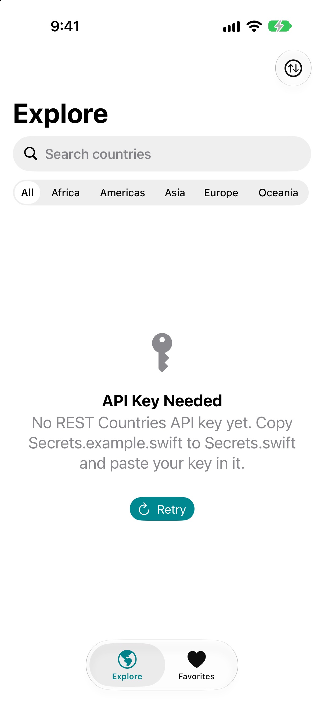
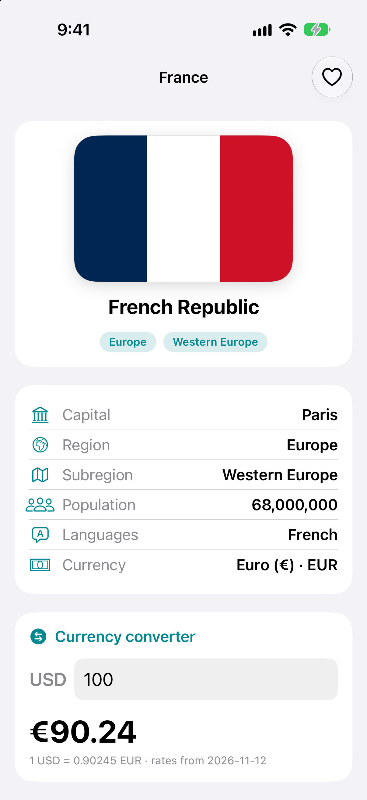
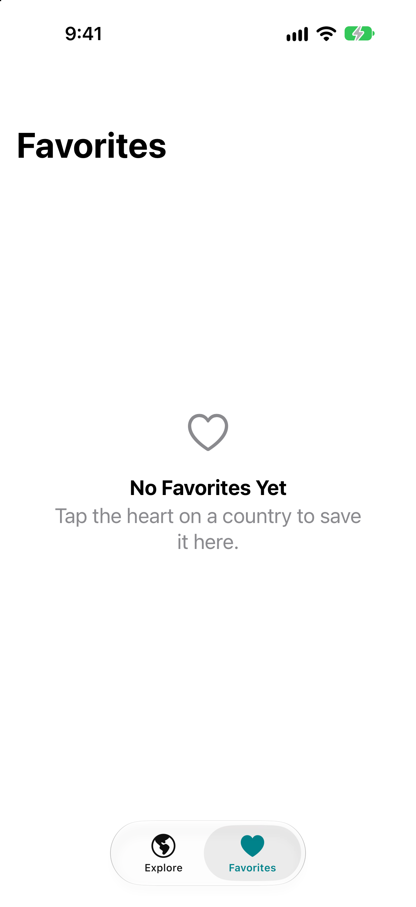

# Abroady Explorer

My final project for the App Team Carolina iOS Bootcamp.

## Purpose

Students planning to study abroad have two big questions: *what is this country like?* and *how far will my money go?*
Abroady Explorer lets you browse every country, save the ones you're considering, and convert US dollars into the local currency.

## Tools

- **SwiftUI**: all the screens (TabView, NavigationStack, List, `.searchable`, Pickers, AsyncImage)
- **URLSession + async/await**: network calls in `CountryService` and `ExchangeService`
- **Codable**: JSON decoding, with `CodingKeys` where the JSON uses snake_case (`alpha_2`, `url_png`)
- **[REST Countries v5](https://restcountries.com)**: country data (needs an API key)
- **[Frankfurter](https://frankfurter.dev)**: free exchange rates (no key)
- **@AppStorage**: saves favorites on the phone

## Features

- **Explore tab**: every country with its flag, name, capital and region chip
  - Search by name (`.searchable`)
  - Filter by region with a segmented Picker (All, Africa, Americas, Asia, Europe, Oceania)
  - Sort by name or population
  - Pull to refresh
- **Country detail**: large flag, official name, capital, region/subregion, population, languages and currency, plus a heart button to save it
- **Currency converter** (inside the detail screen): type an amount in USD and see it in the country's currency at today's rate.
  If Frankfurter doesn't cover that currency (it has about 30), the app says so instead of showing a wrong number.
- **Favorites tab**: your saved countries, swipe to remove, and an empty state
- **Loading and error states**: a spinner while loading, and a friendly error screen with **Retry** for both APIs
- Teal accent color, rounded cards, SF Symbols, and light and dark mode

## Where to find the bootcamp concepts

| Concept | Where |
|---|---|
| ForEach + reusable subviews | `CountryRowView`, `InfoRowView`, `RegionChipView` (`CountryListView`, `CountryDetailView`) |
| @State | `ContentView` (countries, loading, error), `CountryListView` (search, region, sort), `CountryDetailView` (USD amount) |
| User input | search bar, region Picker (segmented), sort Picker, USD TextField with `.decimalPad` |
| @Binding | `FavoriteButton(isFavorite:)` and `CurrencyConverterView(amountText:)` |
| Static async service methods | `CountryService.fetchCountries()`, `ExchangeService.fetchRates(base:)` |
| Codable + CodingKeys | `Models/Country.swift`, `Models/CountryListResponse.swift`, `Models/ExchangeRates.swift` |

## Screenshots

| Explore | Detail + converter | Favorites |
|---|---|---|
|  |  |  |

> **About these screenshots:** they were taken before a REST Countries key was added, so the Explore tab shows the
> "API Key Needed" screen. The detail screenshot is the real detail view showing the France preview sample
> (`Country+Samples.swift`), and the converter in it uses **live** Frankfurter rates. They'll be replaced with screenshots of live data.

## Setup

1. Get a REST Countries API key at https://restcountries.com.
2. In `AbroadyExplorer/AbroadyExplorer/`, copy `Secrets.example.swift` to a new file named **`Secrets.swift`**.
3. Paste your key between the quotes in `Secrets.swift`. This file is in `.gitignore`, so it's never committed.
4. Open `AbroadyExplorer.xcodeproj` (or run `xcodegen generate` first if you changed `project.yml`) and run on an iPhone simulator.

## Project structure

```
AbroadyExplorer/
├── Models/      Country, CountryListResponse, ExchangeRates, Favorites, sample data for previews
├── Services/    CountryService, ExchangeService, APIError
├── Views/       ContentView (tabs), CountryListView, CountryRowView, CountryDetailView, InfoRowView,
│                CurrencyConverterView, FavoriteButton, FavoritesView, RegionChipView, FlagImageView,
│                LoadingView, ErrorView
└── Secrets.example.swift
docs/api-notes.md   the JSON shapes of both APIs
```

## Obstacles

- **Keeping the API key secret.** The key lives in a gitignored `Secrets.swift`, with a committed example file that is excluded from
  the Xcode target. A git pre-commit hook blocks any commit containing the key prefix.
- **Paging.** REST Countries returns at most 100 countries per request, so `CountryService` keeps asking for the next page while `meta.more` is true.
- **Missing fields.** Some territories have no capital or currency, so those properties are Optionals. One odd country no longer breaks the whole list.
- **Limited currencies.** Frankfurter only covers about 30 currencies, so the converter needed a "not supported" message.
- **Segmented picker spacing.** "Americas" was cut off until segments were sized by their content.

## Future additions

- University search for each country
- Cost-of-living estimates (rent, food, transport)
- Visa information for US students
- Real API screenshots and offline caching

---

Built with AI assistance (Claude), which was disclosed to the bootcamp leads.
